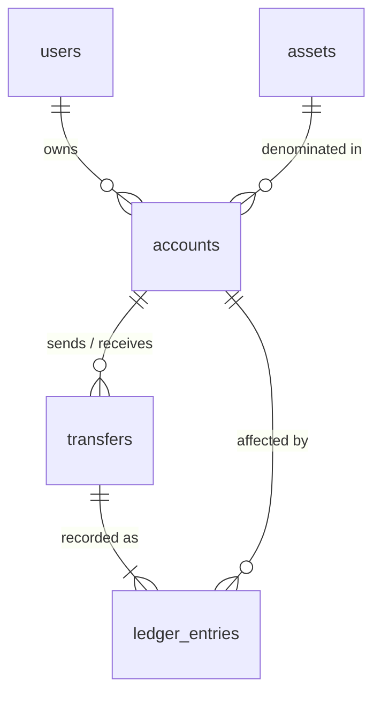

# Mini Exchange

A small cryptocurrency exchange backend, built step by step to learn and demonstrate
backend system design for financial systems: double-entry ledgers, safe concurrent
transfers, idempotency, event-driven microservices, and zero-downtime deployment.

> This is a learning project. Each stage solves a real problem that shows up in
> production exchanges, and the commit history follows that progression.

## Tech Stack

- **Node.js**: application code (no ORM; raw SQL to keep locking and transactions explicit)
- **PostgreSQL 16**: primary database
- **Docker Compose**: local infrastructure
- Coming later: Kafka, RabbitMQ, Redis

## Roadmap

- [x] **Stage 1: Core schema**: users, assets, wallets, double-entry ledger, DB-level constraints
- [ ] **Stage 2: Safe transfers**: transactions, row locking, race conditions, deadlock prevention
- [ ] **Stage 3: Reliable API**: idempotency keys, validation, error handling
- [ ] **Stage 4: Authentication**: JWT access tokens and refresh tokens
- [ ] **Stage 5: Event-driven architecture**: transactional outbox, Kafka, idempotent consumers
- [ ] **Stage 6: CQRS**: rewards service built from transfer events
- [ ] **Stage 7: Background jobs**: RabbitMQ for notifications
- [ ] **Stage 8: Order matching**: a simple order book and Saga pattern
- [ ] **Stage 9: Production readiness**: graceful shutdown, zero-downtime migrations, monitoring

## Data Model



| Table | Purpose |
|---|---|
| `users` | Registered users |
| `assets` | Tradable assets (USDT, BTC, ...) and their precision |
| `accounts` | One wallet per user per asset, holding the current balance |
| `transfers` | One row per money movement |
| `ledger_entries` | Double-entry ledger: every transfer writes one debit and one credit |

### Double-entry ledger

Every transfer produces two ledger entries that sum to zero.
For example, Ali sends 100 USDT to Sara:

| transfer_id | account | amount |
|---|---|---|
| 1 | Ali (USDT) | -100 |
| 1 | Sara (USDT) | +100 |

This gives two invariants that can be checked at any time:

1. The ledger entries of each transfer sum to zero, so money is never created or destroyed.
2. The ledger entries of an account sum to its `balance`, so every balance can be explained.

## Design Decisions

- **Money is stored as `NUMERIC(38, 18)`, never as a float.**
  In JavaScript, `0.1 + 0.2 !== 0.3`. The `pg` driver returns `NUMERIC` as a string to keep precision.
- **Critical rules are enforced by the database, not only by application code.**
  `CHECK (balance >= 0)` rejects a negative balance even if the application has a bug.
- **Financial records are never deleted.**
  Foreign keys from `transfers` and `ledger_entries` prevent removing accounts that have history.
- **`TIMESTAMPTZ` everywhere**, to avoid timezone bugs around daily limits and reports.

## Getting Started

### Prerequisites

- Node.js (LTS)
- Docker Desktop

### Setup

```bash
git clone https://github.com/<your-username>/mini-exchange.git
cd mini-exchange
npm install
cp .env.example .env

npm run db:up        # start PostgreSQL
npm run db:migrate   # create tables
npm run db:seed      # insert sample data
```

### Verify the database constraints

```bash
npm run test:constraints
```

Each line should show the database rejecting an invalid operation
(negative balance, duplicate wallet, self-transfer, and so on).

## Project Structure

```
mini-exchange/
├── db/
│   ├── schema.sql        # tables and constraints
│   └── seed.sql          # sample data
├── src/
│   ├── db.js             # PostgreSQL connection pool
│   ├── migrate.js        # runs a SQL file against the database
│   ├── test-db.js        # connection check
│   └── check-test.js     # constraint tests
├── docker-compose.yml
├── .env.example
└── package.json
```

## References

- Martin Kleppmann, *Designing Data-Intensive Applications*

## License

MIT